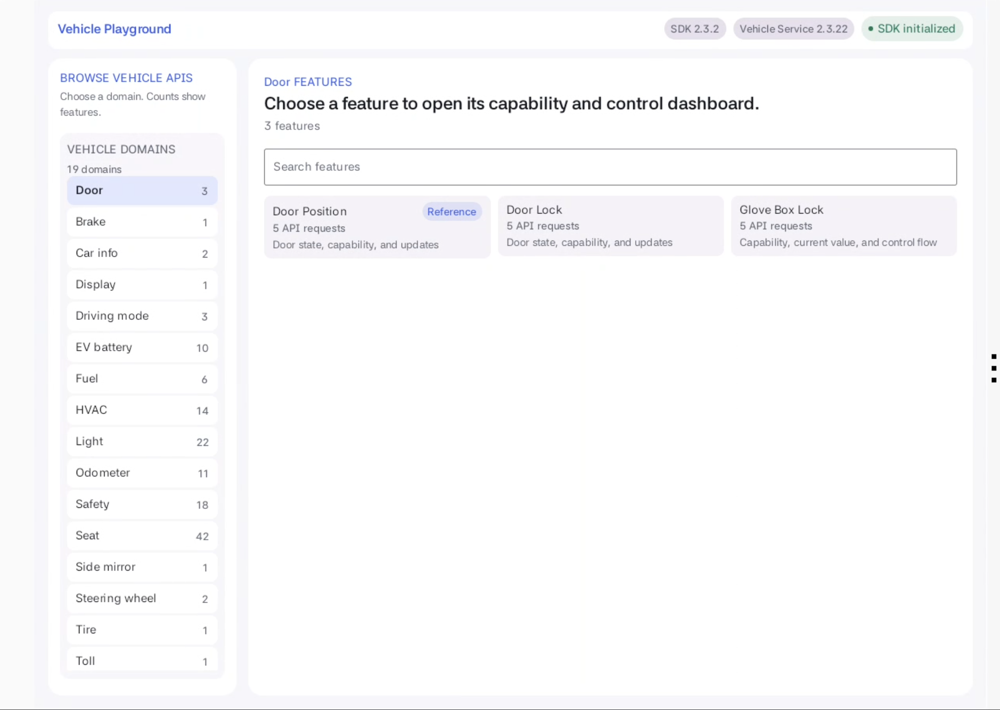
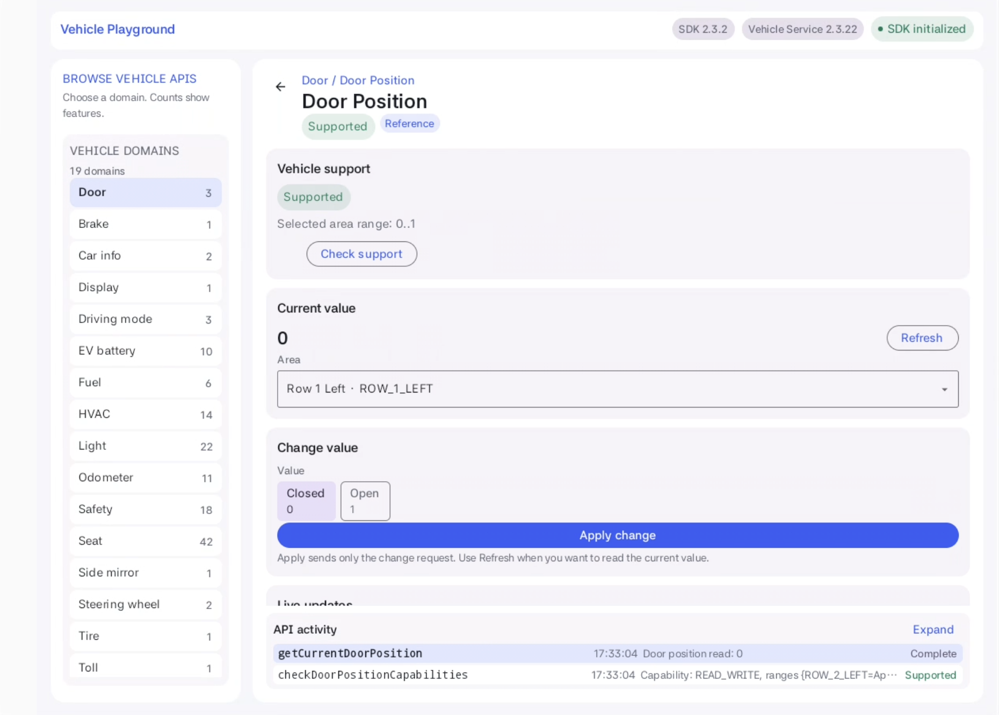
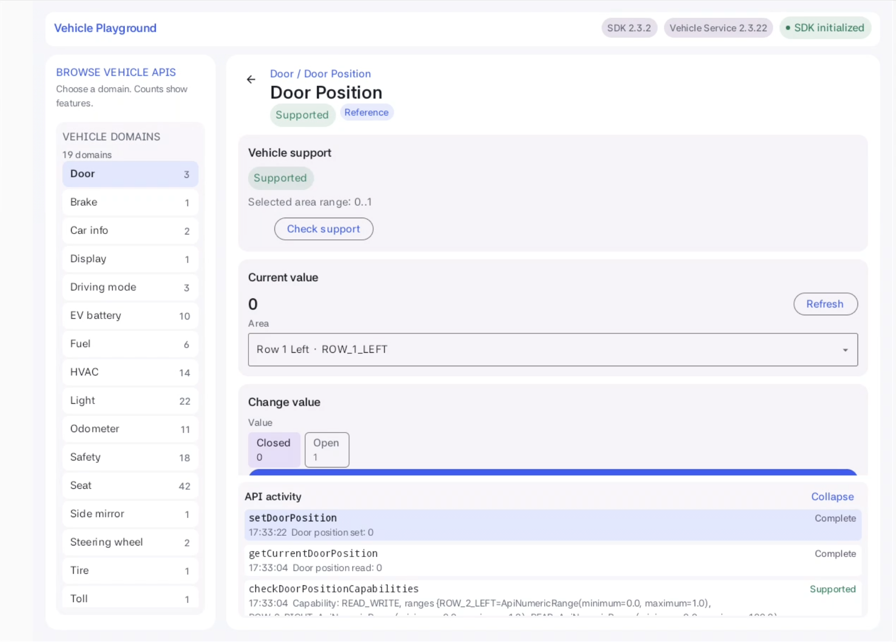
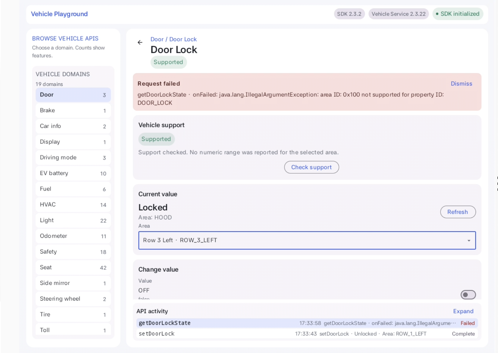
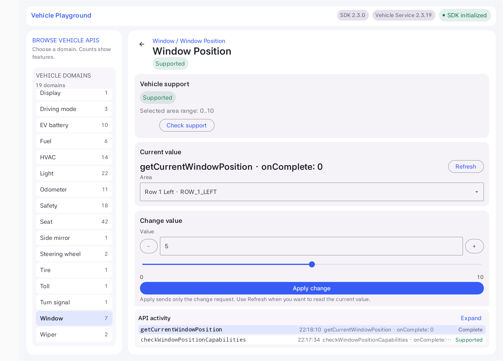

# Pleos Vehicle SDK Android Sample

An Android sample for integrating the Pleos Vehicle SDK `2.3.0`.
The Door Position flow is the official, typed SDK reference in this repository.
The in-app API catalog is a companion screen for discovering public method names,
parameters, and operation order before writing application code.

## What is included

- A typed Door Position reference flow covering capability, read, write, register, and
  unregister patterns.
- A searchable feature catalog grouping 442 non-deprecated public methods across 19 domains:
  Brake, Car info, Display, Door, Driving mode, EV battery, Fuel, HVAC, Light,
  Odometer, Safety, Seat, Side mirror, Steering wheel, Tire, Toll, Turn signal,
  Window, and Wiper.
- Domain counts show grouped **features**, not API methods. For example, Door shows
  **3** features (Door Position, Door Lock, Glove Box Lock), rather than 15 methods.
- The domain sidebar stays visible while a feature is open. The upper-left Back
  action returns to that domain's feature list.
- A compact common app bar keeps the app name, SDK/Service versions and connection
  state visible on both screens. Entering a feature does not move the header or
  domain list; wide layouts use a 64dp bar instead of the previous introduction.
- Area dropdowns, ON/OFF switches, named choices, and numeric editors with +/- buttons.
  Sliders appear only when the capability response supplies a real numeric range.
- A small, fixed **API activity** dock below the scrolling controls. Expand it for
  full method names and responses; additional results never increase its height.
- Explicit **Apply change** for control calls. Editing a value does not send it.

Private, hidden, and deprecated APIs are intentionally excluded. Gear is not part
of this sample's catalog.

The Door Position feature is the reference to copy into an application. Its methods
call the typed Vehicle SDK directly. The catalog is useful for finding the public API
name and its parameter shape, but production code should use the SDK's typed API
directly as shown below.

## Screenshots

Captured on `Pleos_Connect_v2.0` (Android 14), using Vehicle SDK `2.3.0` and
Vehicle Service `2.3.19`. Images show the actual app region cropped from the
2560 x 1440 AVD display, not the HTML prototype.

### Domain counts and feature browsing

Door offers three grouped features. Searching narrows the cards without changing
the domain's total. The same compact app bar remains visible in the dashboard.



### Persistent domains, left Back and discrete controls

The app bar and domain list keep their positions in the dashboard. Door Position's reported
`0..1` range becomes Closed/Open choices. The bottom Activity dock is fixed at
128dp on this wide layout while the controls above it scroll independently.



### Expanded API results

Expand raises the dock to 256dp on this display, without covering the controls.
Each API shows its latest result; the expanded content has its own scroll.
Invoking an API brings its result into view within the dock without moving the
control pane or taking input focus.



### Boolean input and visible failures

The switch prepares an ON/true draft; it does not send a control request.
This AVD rejected the Door Lock read for `ROW_1_LEFT`, so the actual error and
Failed activity status are retained in the screenshot. No Door Lock write is
claimed or shown as successful.



### Real capability range, slider and exact input

Window Position reports `0..10` for `ROW_1_LEFT` on this AVD. The screenshot shows
a draft of 5 selected with the slider; the last read remains 0. The +/- buttons
and direct numeric entry share the same bounds. Areas without reported bounds
show numeric entry without a guessed slider range.



During verification, Door Position SET=1 completed, but an explicit follow-up
read still returned 0. This confirms request completion and separate read behavior,
not a persistent vehicle-state transition. A restore SET=0 completed and the final
read was 0; no test subscriptions were left running.

## Requirements

- Android Studio with Android SDK Platform 35
- JDK 17
- Android 6.0 (API 23) or later
- A Pleos device or emulator containing a compatible Vehicle Service
- Vehicle SDK `2.3.0`

The app cannot exercise vehicle properties on a standard Android phone image because
Pleos Vehicle Service is not available there.

## Dependency

The repository already includes the Pleos Maven repository and dependency:

```kotlin
repositories {
    maven("https://nexus-playground.pleos.ai/repository/maven-releases/")
}

dependencies {
    implementation("ai.pleos.playground:Vehicle:2.3.0")
}
```

## Permissions

The manifest declares the public `CAR_*` read permissions and matching
`CONTROL_CAR_*` permissions required by the 19 supported domains. It does not declare
any `PRIVATE_*` permission.

These Pleos Vehicle Service permissions have `protectionLevel="normal"`, so they do
not use an Android dangerous-permission runtime dialog. Actual property availability
still depends on the connected vehicle or emulator and should be checked through each
capability API.

## Architecture

```text
MainActivity
    └── MainViewModel
            ├── VehicleClient
            │       └── DoorPositionRequests (typed Door integration)
            └── VehicleApiExplorer (public catalog and reflection calls)
                    └── Vehicle SDK 2.3.0 / Vehicle Service
```

- `MainActivity` hosts Compose and forwards UI actions.
- `MainViewModel` owns navigation, grouped feature counts, per-area capability bounds,
  presentation state, and API results.
- `VehicleClient` owns the SDK lifecycle and typed Door calls.
- `SampleApp` contains the domain catalog and feature dashboard.
- `FeatureControlPane` uses shared parameter editors. Read, write and subscription
  actions use the selected area; unknown numeric bounds are never replaced with
  an assumed percentage range.
- `ApiActivityPanel` is a fixed bottom dock with independent expanded scrolling.

## How to use the typed Door API

The SDK calls are asynchronous. Initialize one `Vehicle` session, obtain the typed
`Door` API, check capability first, and then perform read, control, or listener
operations. Always release the session when the owning component is destroyed.

### 1. Create and initialize the session

```kotlin
import android.content.Context
import ai.pleos.playground.vehicle.Vehicle

class DoorPositionClient(context: Context) {
    private val vehicle = Vehicle(context.applicationContext)

    fun initialize() {
        vehicle.initialize()
    }

    fun release() {
        vehicle.release()
    }
}
```

`Vehicle.initialize()` must complete before calling a vehicle property API. If the
service is unavailable or initialization fails, surface the error and do not continue
with property calls.

### 2. Select the area and check capability

The sample uses the driver's first-row area. A capability response tells you whether the
property is available, which access mode is supported, and the valid value range for
each area.

```kotlin
import ai.pleos.playground.vehicle.api.model.area.DoorArea
import ai.pleos.playground.vehicle.constant.area.DoorValue

private val area = DoorArea(DoorValue.ROW_1_LEFT)

fun checkDoorPosition() {
    val door = vehicle.getDoor()
    door.checkDoorPositionCapabilities(
        onComplete = { config, areaBounds ->
            val bounds = areaBounds[area]
            println("access=${config.accessType}")
            println("range=${bounds?.minValue}..${bounds?.maxValue}")
        },
        onFailed = { exception ->
            reportError(exception)
        }
    )
}
```

Use the returned range instead of assuming a universal value range. A vehicle may
support the API but expose different bounds per area, or report that the property is
unsupported.

### 3. Read the current value

Call the read API only after a successful capability check. The result can be `null`
when the service cannot provide a current value.

```kotlin
fun readDoorPosition() {
    val door = vehicle.getDoor()
    door.getCurrentDoorPosition(
        area = area,
        onComplete = { position ->
            println("current position=$position")
        },
        onFailed = { exception ->
            reportError(exception)
        }
    )
}
```

### 4. Set a value

Setting a value changes vehicle state. Validate the value against the capability range,
make sure the capability grants control access, and require an explicit user action
before calling the control API.

```kotlin
fun setDoorPosition(position: Int) {
    val door = vehicle.getDoor()
    door.setDoorPosition(
        area = area,
        value = position,
        onComplete = { _, acceptedValue ->
            println("accepted position=$acceptedValue")
        },
        onFailed = { exception ->
            reportError(exception)
        }
    )
}
```

The sample UI sends this call only when **Apply change** is pressed. Numeric input
must parse as the SDK type and stay inside the selected area's reported range, if
available. Door Position with a `0..1` range uses **Closed / Open**, not a percentage
slider. Other ranges use a slider plus exact numeric entry.

A successful SET acknowledgement appears in API activity. It does not trigger an
automatic GET or replace the displayed measured value. Press **Refresh** to read
the current value; an active listener can also update it.

### 5. Register and unregister updates

Keep the same listener instance for both operations. Unregister it before releasing the
Vehicle session or when the observing screen/component stops.

```kotlin
import ai.pleos.playground.vehicle.listener.DoorPositionListener

private val doorPositionListener = object : DoorPositionListener {
    override fun onPositionUpdated(pos: Int?) {
        println("door position updated=$pos")
    }

    override fun onFailed(exception: Exception) {
        reportError(exception)
    }
}

fun registerDoorUpdates() {
    vehicle.getDoor().registerDoorPosition(area, doorPositionListener)
}

fun unregisterDoorUpdates() {
    vehicle.getDoor().unregisterDoorPosition(area, doorPositionListener)
}
```

A complete owner follows this order:

```kotlin
initialize()
checkDoorPosition()
readDoorPosition()
setDoorPosition(position = 0) // only after capability and user confirmation
registerDoorUpdates()
unregisterDoorUpdates()
release()
```

The exact sequence can be adapted to the screen or service lifecycle, but a listener
must not outlive the `Vehicle` session that registered it. Because these APIs are
asynchronous, start each next step from the previous call's successful callback (or
an equivalent coroutine/state machine) rather than running the sequence synchronously.

### Complete lifecycle shape

For reference, the sample's client follows this lifecycle:

```kotlin
val vehicle = Vehicle(context)
vehicle.initialize()

val door = vehicle.getDoor()
// checkDoorPositionCapabilities / getCurrentDoorPosition /
// setDoorPosition / registerDoorPosition / unregisterDoorPosition

vehicle.release()
```

## Run

1. Start a compatible Pleos emulator or connect a safely parked test vehicle.
2. Build and install the debug APK:

   ```bash
   JAVA_HOME=/path/to/jdk-17 ./gradlew installDebug
   ```

3. Open **Vehicle SDK Sample**.
4. The app opens with **Door** selected at the top of the domain list. Open
   **Door Position** to follow the typed integration reference.
5. Opening a feature checks its capability and performs an initial read after a
   successful check. **Check support** can repeat the capability request.
6. Choose an area, edit the value with its type-specific control, then press
   **Apply change**. Use **Refresh** to read the result. These diagnostic actions
   remain independent; they are not a mandatory step-by-step wizard.
7. Watch **API activity** at the bottom while scrolling the controls. The compact
   dock shows two recent method results on wide layouts, or one on narrower layouts.
   **Expand / Collapse** changes the dock size explicitly.
8. Use **Start updates / Stop updates** to test the listener APIs. Stop a typed
   Door subscription using its registered area. Switching the typed subscription
   to another area unregisters the old area with the same listener first.
9. Use the upper-left Back arrow for another feature or choose a different domain
   directly. On narrow layouts, **Browse domains** remains available in the dashboard.

Missing permissions, unsupported capabilities, incompatible services, and callback
failures are displayed in the result area.

## Target SDK versioning

Sample releases encode the target Android SDK in both Android version fields:

```text
versionName = <major>.<minor>.<patch>-sdk<targetSdk>
versionCode = targetSdk * 1,000,000 + major * 10,000 + minor * 100 + patch
```

For this SDK 35 release:

```text
minSdk = 23
targetSdk = 35
versionName = 1.0.0-sdk35
versionCode = 35010000
```

## Verify

Run all local checks with JDK 17:

```bash
JAVA_HOME=/path/to/jdk-17 ./gradlew lintDebug testDebugUnitTest assembleDebug
```

Run Compose UI tests on a connected compatible emulator:

```bash
JAVA_HOME=/path/to/jdk-17 ./gradlew connectedDebugAndroidTest
```

Tests cover retained navigation, fixed dock geometry, feature counts, parameter
editors, numeric validation, actual capability-bound extraction, selected Door
areas, listener cleanup, and separate SET/read behavior.

Known existing test mismatch: `PublicApiPolicyTest` still pins the SDK `2.2.10`
catalog to 441 methods, while the current `2.3.0` dependency exposes 442. That
assertion is not skipped or relaxed; it remains a failure in the full unit suite.
